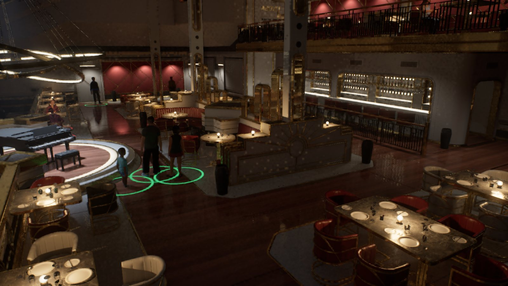
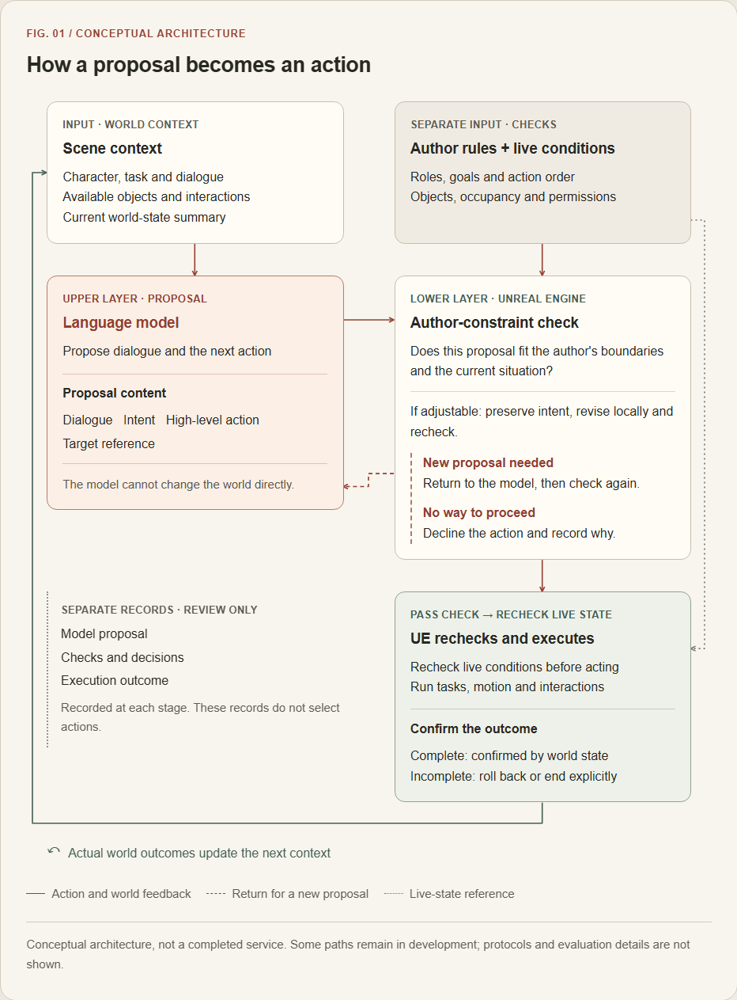
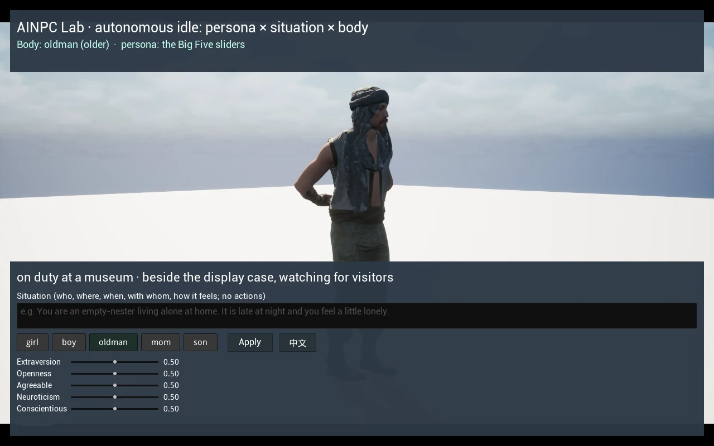
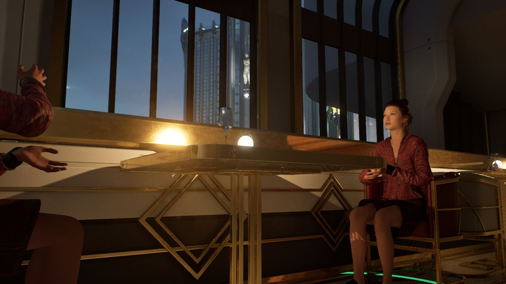
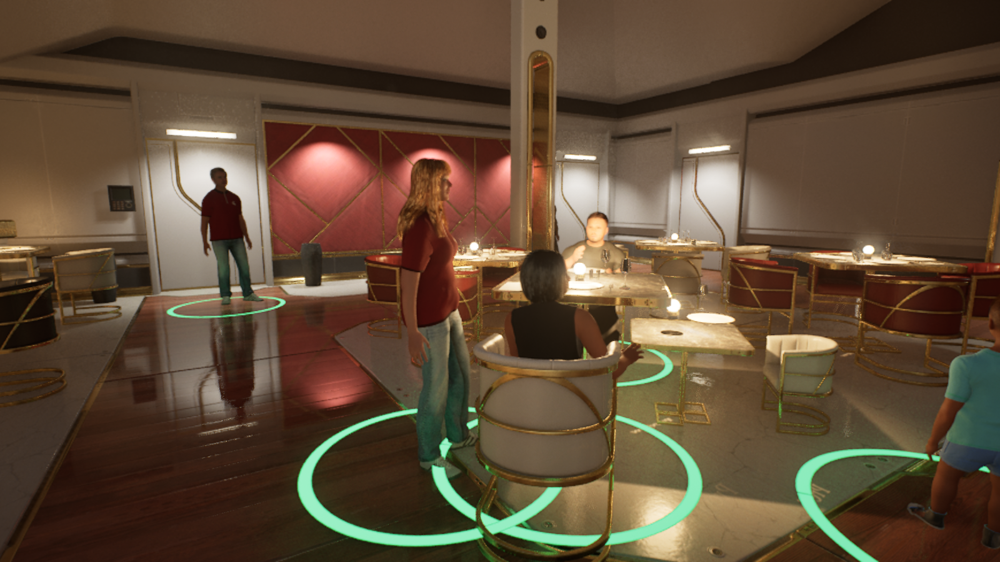

[English](README.md) | [简体中文](README.zh-CN.md)

# AINPC CHI — Author-Constrained Improvisation

> **Repository scope · 24 October 2026**
> This public repository is now **AINPC CHI**, the research overview for *Author-Constrained Improvisation*. It preserves the existing research history, images and disclosure boundaries. Standalone AINPC product development now lives in a separate private **AINPC** repository; its implementation and validation data are not published here. The research overview below retains its original evidence scope and dates.
>
> **Update · 9 November 2026** — This overview now mirrors the website section on recent persona, situation and body work, with one redacted test-bench screenshot. Implementation, validation data and test figures stay in the private repository.

[Project page](https://ruixiaozhang.com/index_EN#work-ainpc)

AINPC studies how game characters can improvise while authors retain control of their worlds. Using a restaurant prototype in Unreal Engine, I explore how creators can preserve rules and context when language models contribute to character dialogue and action.

The restaurant prototype. These development stills show the setting and character relationships, not validation of complete tasks or synchronized speech.

## Why a restaurant

A restaurant makes this question tangible. Guests and service staff share space and objects, so one character's choice affects others. An action that the engine can execute may still ignore an earlier commitment or the intended order of service. The system therefore needs to consider both whether an action can happen and whether it fits the author-defined context.

## My work and approach

I develop the research framework, interaction design and UE prototype integration, connecting model proposals, local checks and character tasks alongside dialogue, captions and speech. The prototype uses MetaHuman and existing character, animation and environment assets.

The design separates responsibilities: the language model proposes dialogue and high-level actions, author constraints check whether they fit, and UE retains authority to execute and change world state. Subsequent decisions use actual execution outcomes. Proposals, checks and results are recorded separately for review. The diagram maps these responsibilities; some paths remain in development.

Conceptual architecture, not a completed service. Some paths remain in development; protocols and evaluation details are not shown.

## Motion, hands and shared objects

The execution work also considers three levels: situation and presentation, whole-body motion, and hand states. These describe how an action is expressed; they do not replace the author-constraint checks. A learned situation-to-presentation mapping remains future work. The current body-motion representation uses a linear projection, while learned alternatives remain under comparison. Hand states are working descriptions, not validated grasp categories.

Current development also addresses sharing objects and taking a seat when several guests are present. These are development rules, not a completed autonomous service. The [dated method notes](https://github.com/Shawn200212/AINPC-CHI/tree/main/docs/methods) describe their purpose and limits without publishing implementation details.

## Recent work: persona, situation and body

Since October 2026, development has focused on one character's complete presence. Persona, situation and body together shape what the character attends to while it waits, how it stands and which small actions it makes. A test bench lets me enter a situation (who, where, when, with whom, how it feels), then compare autonomous idle behaviour across Big Five persona sliders and different bodies. The model first splits the situation into parts and reads it through the persona; the body then chooses its idle posture.

This work is in progress. Overall motion naturalness has not passed my own checks, and contact and joint problems in some actions are still being fixed. Dialogue, speech and body motion have each run in the engine; they still need to be joined into one stable, continuous experience. The test-bench screenshot below is a development view, not a finished game experience.

A development screenshot of the test bench: an older body idles in a ‘museum duty’ situation, hands behind the back. Internal values and action names are hidden, and the interface labels are translated into English for this page. The character is an existing asset.

## Research focus and limits

The research distinguishes conformity to an author's intent from successful execution. Examining them separately could help creators understand unexpected character responses and revise their designs. This potential benefit still needs evaluation, with separate evidence for execution reliability and player experience.

Dialogue, speech and some character interactions have working paths. The next step is to make one character's idle behaviour, dialogue and motion run continuously, then extend the work to player interaction and to interaction among several characters. A complete autonomous service flow is unfinished, and formal gameplay evaluation has not begun. This overview shares the research approach and prototype setting; operational scoring rules, prompts, algorithm implementations, evaluation data and findings remain private.

## Prototype scenes

### A place for conversation

Conversation sits within a shared table setting, where character orientation, distance and nearby objects provide context for interaction.

### Characters in a shared situation

Guests and service staff inhabit the same environment. Their relationships provide a setting for examining authored intentions and action choices.

## Related pages

[Dated method notes](docs/methods/README.md) · [Prototype guide](docs/PROTOTYPE_GUIDE.md) · [Version scope](docs/VERSION_SCOPE.md)

[AIWG](https://github.com/Shawn200212/AI-World-Generator)

[Disclosure](DISCLOSURE.md) · [Image inventory](docs/public-media.json) · [Rights and credits](RIGHTS_AND_CREDITS.md)

Overview updated 9 November 2026. The narrative, conceptual figure, scene images and test-bench screenshot mirror the project website. This repository is a research overview, not a runnable project or a complete research artifact.
