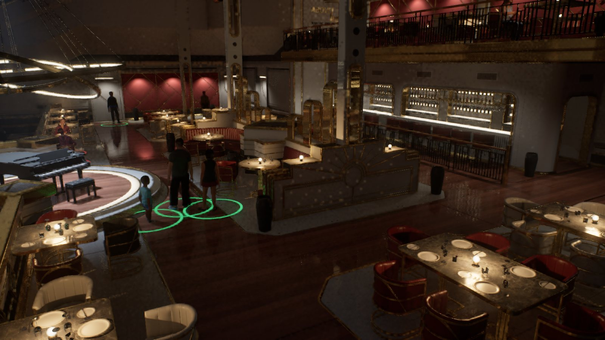
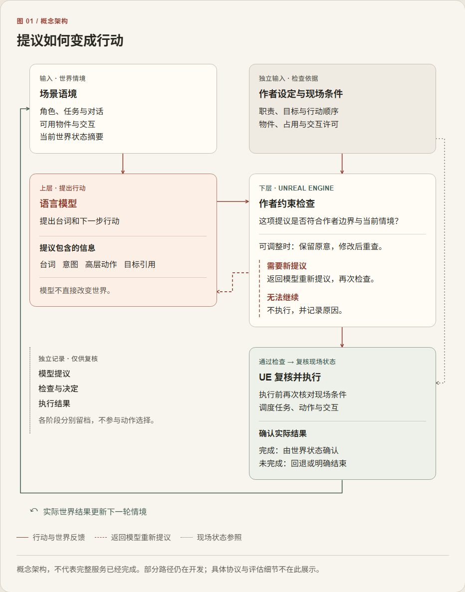
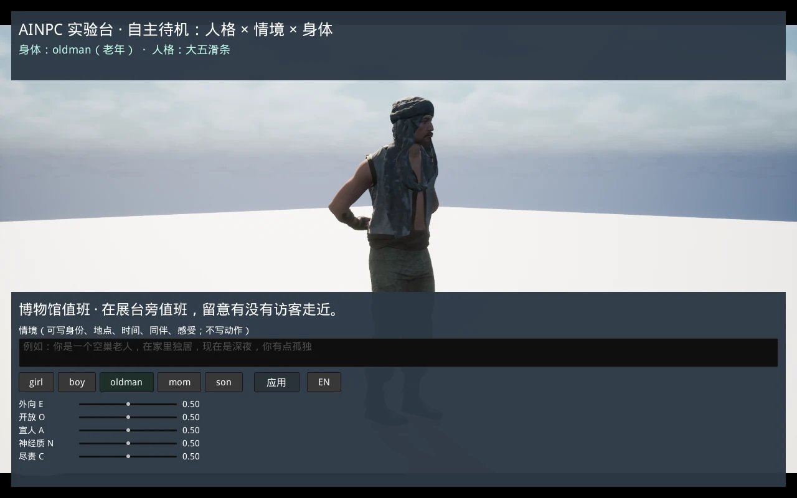
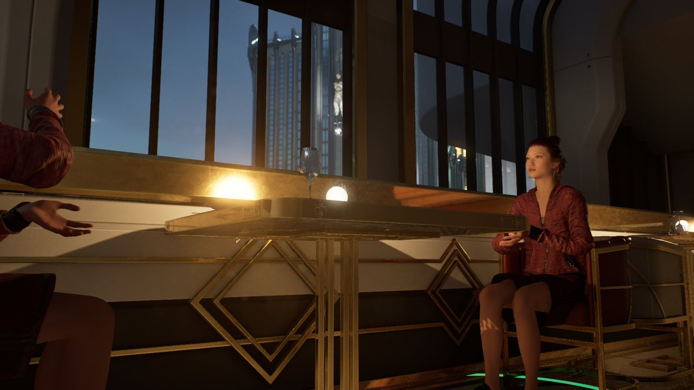
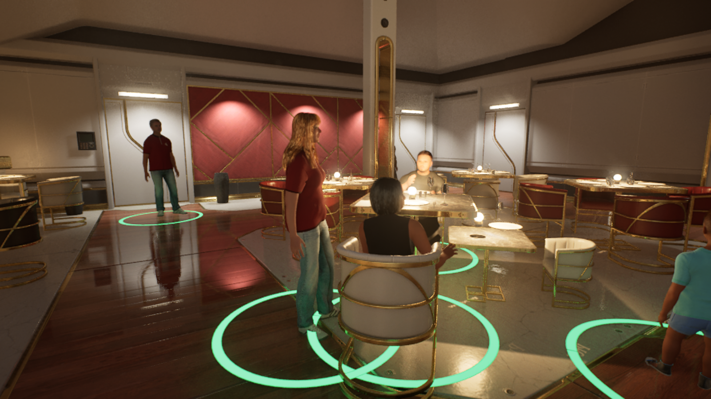

[English](README.md) | [简体中文](README.zh-CN.md)

# AINPC CHI — 作者约束的即兴行动

> **仓库范围 · 2026 年 10 月 24 日**
> 本公开仓库现命名为 **AINPC CHI**，继续用于“作者约束的即兴行动”研究介绍，保留既有历史、图片和公开边界。纯 AINPC 产品开发已独立至新的私有 **AINPC** 仓库，其实现和验证数据不在本仓公开。下方研究介绍保留原有证据范围与日期。
>
> **更新 · 2026 年 11 月 9 日**：本概览同步网站上关于人格、情境与身体的近期进展，以及一张遮盖过的实验台截图。实现、验证数据与测试数字仍在私有仓库。

[项目网页](https://ruixiaozhang.com/#work-ainpc)

AINPC 研究游戏角色的即兴回应与作者控制如何共存。我以 Unreal Engine 中的餐厅为原型场景，探索语言模型参与角色对话和行动后，创作者如何继续掌握世界的规则与情境。

餐厅原型总览。以下开发静帧呈现场景与角色关系，不作为完整任务或语音同步的验证。

## 为什么选择餐厅

餐厅把这个问题放进了日常可理解的关系中：顾客与服务人员共享空间和物件，一个角色的选择会影响其他人。即使动作在引擎中可以执行，也可能忽略先前的承诺或应有的服务顺序。因此，系统既要处理行动能否发生，也要考虑它是否符合作者设定的情境。

## 我的工作与方案

我负责研究框架、交互设计和 UE 原型集成，将模型提议、本地检查与角色任务连接起来，并集成对话、字幕和语音。原型使用 MetaHuman，以及既有的角色、动画和环境资产。

方案采用分层分工：语言模型根据情境提出台词和高层行动，作者约束检查提议是否合适，UE 保留执行和改变世界状态的权限。后续决策以实际执行结果为依据。提议、检查与结果另行记录，供事后复核；下图展示这些职责关系，部分路径仍在开发。

概念架构，不代表完整服务已经完成。部分路径仍在开发；具体协议与评估细节不在此展示。

## 动作、手部与共享物件

在执行侧，我还探索三个层次的表征：情境与表现、全身动作、手部状态。它们处理行动如何呈现，不取代作者约束检查。情境到表现的学习映射仍是后续工作；当前身体动作表征使用线性投影，学习模型仍在比较中。手部状态是开发中的描述，不是经过验证的抓握分类。

近期开发还关注多位顾客在场时如何共用物件、接近桌边并入座。这些是正在完善的执行规则，不代表完整自主服务已经完成。[按日期整理的方法说明](https://github.com/Shawn200212/AINPC-CHI/tree/main/docs/methods)介绍了这些工作的目的和限制，不公开具体实现。

## 近期进展：人格、情境与身体

2026 年 10 月起，我把开发重点转向单个角色的完整表现。人格、情境与身体共同影响角色在等待时关注什么、怎样站立、做出哪些小动作。为此我做了一个实验台：输入一段情境（身份、地点、时间、同伴、感受），再用大五人格滑条和不同的身体，比较角色的自主待机。模型先把情境拆成几个部分，再按这个人格读出情境；身体据此选择待机的姿态。

这项工作仍在进行。整体动作的自然度还没有通过我的检查，部分动作的接触与关节仍在修正。对话、语音与身体动作已分别在引擎中运行，还需要连成稳定、连续的体验。下方的实验台截图是开发画面，不代表完成的游戏体验。

实验台的开发截图：老年身体在“博物馆值班”的情境中自主待机，双手背在身后。内部数值与动作名称已隐去；角色为既有资产。

## 研究关注与当前限制

研究的重点是区分“符合作者意图”与“实际执行成功”。把两者分别检查，有望帮助创作者理解角色的意外回应来自哪里，并据此调整设计。这一潜在价值仍需验证，执行可靠性与玩家体验也需要各自的证据。

目前，对话、语音和部分角色交互已有运行路径。下一步先让单个角色的待机、对话与动作连续运行，再扩展到玩家交互和多个角色之间的互动。完整自主服务链尚未完成，正式游玩评估尚未开展。这里公开研究思路与原型场景；具体评分规则、提示词、算法实现、评估数据和研究结果暂不公开。

## 原型场景

### 对话发生的空间

对话被放在具体的餐桌情境中，角色的朝向、距离与周围对象共同构成互动背景。

### 共享情境中的多角色

顾客与服务人员处于同一环境，角色之间的关系为研究作者意图与行动选择提供语境。

## 相关页面

[按日期整理的方法说明](docs/methods/README.md) · [原型导览](docs/PROTOTYPE_GUIDE.md) · [版本范围](docs/VERSION_SCOPE.md)

[AIWG](https://github.com/Shawn200212/AI-World-Generator)

[公开范围](DISCLOSURE.md) · [图片清单](docs/public-media.json) · [权利与署名](RIGHTS_AND_CREDITS.md)

概览更新于 2026 年 11 月 9 日。正文、概念图、场景图和实验台截图与项目网页保持一致。本仓用于研究介绍，不是可运行工程或完整研究材料。
